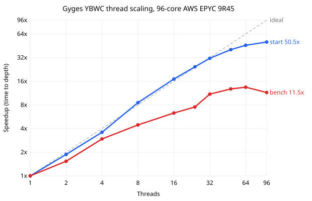

# Overview

A Rust engine and library for the board game Gygès. The engine evaluates positions with a trained neural network, searches with a parallel alpha-beta search, and runs natively or in a web browser through WebAssembly. Technical details are in the [engine README](gyges_engine/README.md). You can also play against the computer on my website [gyges.app](https://gyges.app).

Gygès is a two-player strategy game on a 6×6 board with 12 pieces of 1, 2, or 3 rings. No piece belongs to either player: each turn, a player moves a piece from the occupied row closest to them, exactly as many squares as it has rings. A piece that lands on another can continue moving or displace it, and a player wins by moving a piece into the goal behind the opponent's home row. The full rules are in the [library README](gyges/README.md#the-game).

The latest release (V2.0.0) is a major update: in self-play matches, it wins **97%** of [decisive sets](gyges_engine/README.md#results) against the previous version (V1.1.0).

The project is made up of two crates:
- [`gyges_engine`](gyges_engine): the engine, and the core of the project. It contains the neural network and search described below, and communicates over the [UGI protocol](gyges_engine/UGI-Protocol-Specification.md), a UCI-style text protocol designed for it.
- [`gyges`](gyges): the performance-oriented library the engine is built on, producing all legal moves for a board in ~1 µs.

# Engine Search Overview

The engine uses a Negamax alpha-beta with principal variation search, driven by iterative deepening over odd depths with aspiration windows. A lockless, clustered transposition table keyed by Zobrist hashes is shared across all threads. Strict move ordering, which prunes losing candidates early, mitigates Gygès' branching factor of hundreds of moves.

The search is parallelized with the Young Brothers Wait Concept (YBWC), with split points anywhere in the tree. On a 96-core server it reaches a **50.5x** speedup, scaling near-linearly to 32 threads:



# Engine Neural Network Overview

Game positions are evaluated by a small feedforward neural network, specifically an MLP (multi-layer perceptron). Its format is as follows:

```
5,886 sparse binary inputs  ->  1,024 hidden (ReLU)  ->  1 output (tanh)
```

The 5886 inputs encode positional piece pairings, capturing their complex relationships that determine who is winning in the game. With only 12 pieces on the board, only 78 inputs are ever active, allowing microsecond-level inference that makes it practical inside an alpha-beta search.

**Training.** It was trained on ~28 million board positions (after augmentation) from games the V1.1.0 engine played against itself, generated on an AWS EC2 Linux server. Each position is labeled with its corresponding game's final result, scaled to ±0.75, allowing the network to learn, from game outcomes alone, which positional patterns lead to winning. Trained in PyTorch with MSE loss, Adam (learning rate 0.001), batch size 4,096, 0.5 dropout, and an 80/20 train/validation split; the shipped weights are from epoch 9, at the validation plateau.

**Result.** With identical search on both sides, the network wins **97%** of decisive sets against the V1.1.0 evaluation it replaced, across multiple search parameters.

# Engine Usage

Play against the engine at [gyges.app](https://gyges.app), download a prebuilt binary from the [releases page](https://github.com/Beck-Bjella/Gyges/releases), or build from source:

```bash
cargo build --release -p gyges_engine
```

The engine communicates over UGI; see the [engine README](gyges_engine/README.md) for commands and options.

# Basic Library Usage

Add the library to `Cargo.toml`:

```toml
[dependencies]
gyges = "2.0.0"
```

### Setting Up a Board

Load the standard starting position:

```rust
use gyges::*;

let board: BoardState = BoardState::from(STARTING_BOARD);
```

Or load a custom position. Each row is six digits, where `0` is an empty square and `1` to `3` is a piece's ring count. Rows run from your home row to the opponent's, separated by `/`:

```rust
use gyges::*;

let board: BoardState = BoardState::from("321123/000000/000000/000000/000000/321123");
```

### Generating Moves

`MoveGen` generates moves and move-related data. It takes two generic parameters:

- **`GenType`**, what to generate:
  - `GenMoves`: all legal moves.
  - `GenMoveCount`: the number of legal moves.
  - `GenThreatCount`: the number of threats, moves that reach the goal.
  - `GenControlMoveCount`: the move count, plus the squares and pieces the player can reach.
- **`QuitType`**, when to stop:
  - `NoQuit`: run the full generation.
  - `QuitOnThreat`: stop as soon as a threat is found, which saves work when only the absence of threats matters.

Generate all moves:

```rust
use gyges::*;

let mut board: BoardState = BoardState::from(STARTING_BOARD);
let mut move_gen: MoveGen = MoveGen::default();

let data: GenResult = unsafe { move_gen.gen::<GenMoves, NoQuit>(&mut board, Player::One) };
let mut movelist: RawMoveList = data.move_list;
let moves: Vec<Move> = movelist.moves(&mut board);
println!("Generated moves: {:?}", moves);
```

Count moves, stopping early if a threat is found:

```rust
use gyges::*;

let mut board: BoardState = BoardState::from(STARTING_BOARD);
let mut move_gen: MoveGen = MoveGen::default();

let data: GenResult = unsafe { move_gen.gen::<GenMoveCount, QuitOnThreat>(&mut board, Player::One) };
println!("Move count: {}", data.move_count);
```

### Making a Move

`make_move` applies a move to the board in place, and `unmake_move` reverses it:

```rust
use gyges::*;

let mut board: BoardState = BoardState::from(STARTING_BOARD);
let mut move_gen: MoveGen = MoveGen::default();

let data: GenResult = unsafe { move_gen.gen::<GenMoves, NoQuit>(&mut board, Player::One) };
let mut movelist: RawMoveList = data.move_list;
let moves: Vec<Move> = movelist.moves(&mut board);

board.make_move(&moves[0]);
println!("After the move: {}", board);

board.unmake_move(&moves[0]);
println!("Restored: {}", board);
```

# Contributions

Contributions are welcome. Open a pull request, or open an issue to report a bug or suggest an improvement.

By submitting a contribution, you confirm you have the right to submit it, and you grant Beck Bjella a perpetual, irrevocable license to use, modify, and relicense it under any license, including the project's current licenses.

# License

Copyright © 2022-2026 Beck Bjella. The engine is released under the [GNU Affero General Public License v3.0](gyges_engine/LICENSE), and the library under the [GNU General Public License v3.0](LICENSE).
