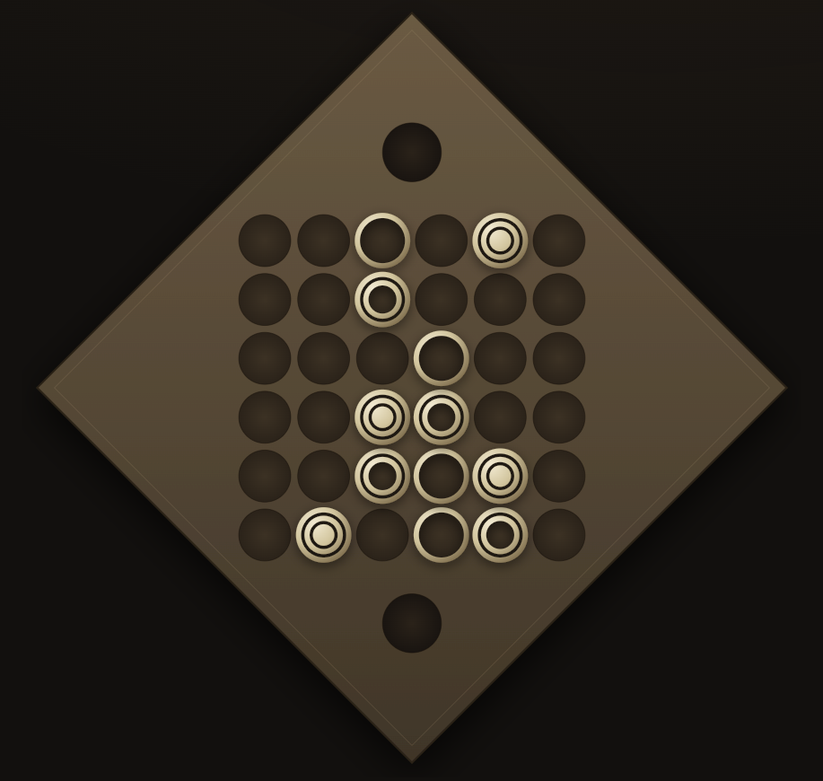

# Overview

A performance-oriented Rust library implementing the board game Gygès: board representation, move generation, and supporting types. It is the foundation of the [Gygès engine](https://github.com/Beck-Bjella/Gyges/tree/main/gyges_engine).

[Documentation](https://docs.rs/gyges) · [crates.io](https://crates.io/crates/gyges)

## The Game
Gygès is a two-player strategy game on a 6×6 board. Each player starts with six pieces on their home row: two each with one, two, and three rings. The pieces belong to neither player. On each turn, a player moves one piece from the occupied row closest to them.

- A piece moves exactly as many squares as it has rings, one orthogonal step at a time, without passing through other pieces.
- A piece that ends its move on another piece either continues moving by that piece's ring count, or takes that piece's square and places the displaced piece on any empty square not behind the opponent's closest occupied row.
- Every move must change the board.
- A player wins by moving a piece into the goal behind the opponent's home row.

<p align="center">
  <a href="https://gyges.app"></a>
</p>

# Features

- **Hyper-efficient move generation:** a full legal move list in about 1 µs and a move count in about 120 ns (median over 60 varied positions on a laptop CPU).
  - **Table lookups instead of path walking.** For 2- and 3-ring pieces, the BMI2 `pext` instruction compresses the pieces that could block a move into an index, which selects a precomputed list of exactly the unblocked paths (365 lists for 2-ring pieces, 8,389 for 3-ring pieces).
  - **Bitboard bookkeeping.** Bounces are followed on an explicit stack, with bitboards tracking used path segments and already-bounced pieces; the board itself is never copied.
  - **Generic implementation.** Generation is generic over the data it collects (moves, move counts, threat counts, or reachable squares), so each caller computes only what it needs, for maximum performance with minimal code duplication.
- **Optimized move representation:** move lists are stored as encoded bitboards and decoded into full move objects only on demand.
- **Board representation** with in-place make/unmake and incrementally updated Zobrist hashes.
- **A lockless, clustered transposition table** for multithreaded search.
- **Core types** for pieces, squares, players, moves, and move lists.

# Platforms

The library builds for any target Rust supports, including WebAssembly. On x86-64 CPUs with BMI2 (enabled with `-C target-cpu=x86-64-v3` or `-C target-feature=+bmi2`), move generation uses the hardware `pext` instruction; other targets use a portable fallback with identical results.

# Basic Library Usage

Add the library to `Cargo.toml`:

```toml
[dependencies]
gyges = "2.0.0"
```

### Setting Up a Board

Load the standard starting position:

```rust
use gyges::*;

let board: BoardState = BoardState::from(STARTING_BOARD);
```

Or load a custom position. Each row is six digits, where `0` is an empty square and `1` to `3` is a piece's ring count. Rows run from your home row to the opponent's, separated by `/`:

```rust
use gyges::*;

let board: BoardState = BoardState::from("321123/000000/000000/000000/000000/321123");
```

### Generating Moves

`MoveGen` generates moves and move-related data. It takes two generic parameters:

- **`GenType`**, what to generate:
  - `GenMoves`: all legal moves.
  - `GenMoveCount`: the number of legal moves.
  - `GenThreatCount`: the number of threats, moves that reach the goal.
  - `GenControlMoveCount`: the move count, plus the squares and pieces the player can reach.
- **`QuitType`**, when to stop:
  - `NoQuit`: run the full generation.
  - `QuitOnThreat`: stop as soon as a threat is found, which saves work when only the absence of threats matters.

Generate all moves:

```rust
use gyges::*;

let mut board: BoardState = BoardState::from(STARTING_BOARD);
let mut move_gen: MoveGen = MoveGen::default();

let data: GenResult = unsafe { move_gen.gen::<GenMoves, NoQuit>(&mut board, Player::One) };
let mut movelist: RawMoveList = data.move_list;
let moves: Vec<Move> = movelist.moves(&mut board);
println!("Generated moves: {:?}", moves);
```

Count moves, stopping early if a threat is found:

```rust
use gyges::*;

let mut board: BoardState = BoardState::from(STARTING_BOARD);
let mut move_gen: MoveGen = MoveGen::default();

let data: GenResult = unsafe { move_gen.gen::<GenMoveCount, QuitOnThreat>(&mut board, Player::One) };
println!("Move count: {}", data.move_count);
```

### Making a Move

`make_move` applies a move to the board in place, and `unmake_move` reverses it:

```rust
use gyges::*;

let mut board: BoardState = BoardState::from(STARTING_BOARD);
let mut move_gen: MoveGen = MoveGen::default();

let data: GenResult = unsafe { move_gen.gen::<GenMoves, NoQuit>(&mut board, Player::One) };
let mut movelist: RawMoveList = data.move_list;
let moves: Vec<Move> = movelist.moves(&mut board);

board.make_move(&moves[0]);
println!("After the move: {}", board);

board.unmake_move(&moves[0]);
println!("Restored: {}", board);
```

# Upgrading from 1.x

- `make_move` now changes the board in place instead of returning a new `BoardState`. Use `unmake_move` to reverse a move, or `make_move_clone` to get a new board and keep the original.
- Move generation no longer produces moves that leave the board unchanged.

# Acknowledgements

The project structure and formatting were inspired by the Rust chess engine [Pleco](https://github.com/pleco-rs/Pleco).

# Contributions

Contributions are welcome. Open a pull request, or open an issue to report a bug or suggest an improvement.

# License

Released under the [GNU General Public License v3.0](https://github.com/Beck-Bjella/Gyges/blob/main/LICENSE).
